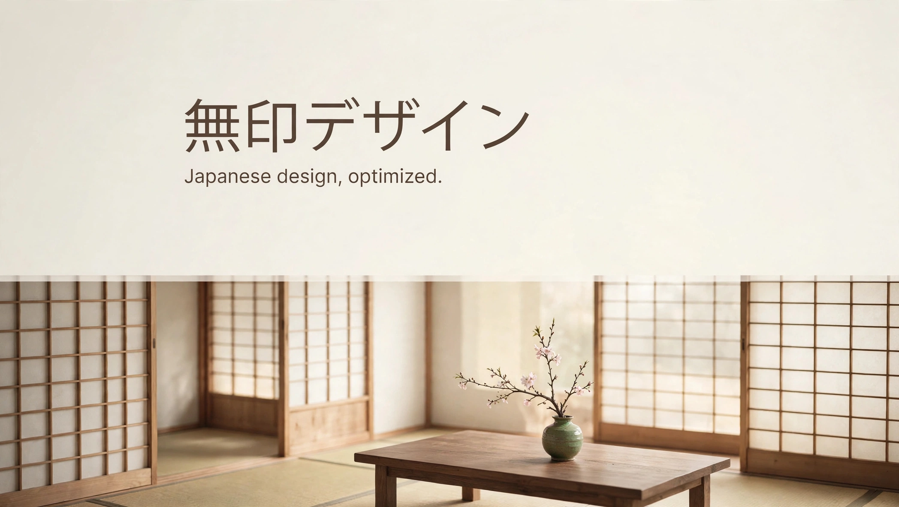
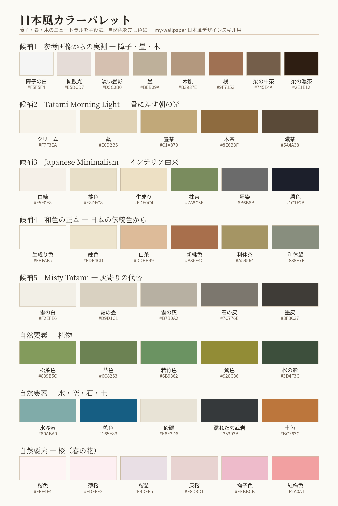

# muji-design

An Agent Skills design skill that gives coding agents (VS Code Copilot, OpenCode, and others) a Japanese design language for generating UI — grounded in the philosophy of MUJI (無印良品), the spatial grammar of the Japanese room, and a 46-color reference palette to use as a base.

コーディングエージェントが UI を生成する際に使う、Agent Skills 形式のデザインスキルです。日本的デザインのベースを無印良品の思想に置き、和室の空間文法と、ベースとなる46色パレットで様式の土台を作ります。

> **Status: under development.** The design foundations (direction, elements, color palette) are decided and documented in this repository. The `SKILL.md` itself is in preparation.

## Philosophy ― ベースは無印良品、核は最適化

- **素材の選択** — 色と質感は、素材由来のものをそのまま使う（生成り、無垢の木、畳、石、苔、桜）。
- **工程の見直し** — 操作の手順と画面遷移から無駄を省き、少ない手数で届く場所に置く。
- **包装の簡略化** — 枠・バッジ・装飾という「包み」を減らし、中身を直接見せる。
- 判定軸はひとつ:「この画面は、無印良品の棚と画面に置いて違和感がないか」。

## Elements ― 和室の建築要素

観光記号（鳥居・富士山など）は使いません。和室の建築そのものから要素を取ります。

- **桟と格子** — 障子の細い縦横の線 → 区切り線、リストの行、ナビゲーションの縦線
- **間** — 何も置かない領域そのものを、最初に確保する要素として扱う
- **低い水平線** — 鴨居のような横の帯で画面を区切り、要素の高さを低く揃える
- **床の間** — 主役を1つだけ置く場所。他の要素はすべて引き立て役
- **敷居と段** — 面の色を一段変えるだけで区画を示す。枠では囲まない
- **障子の面と拡散光** — 半透明の白い面、柔らかく回る光、面同士の明暗差で生まれる陰影
- **引き戸の動き** — 画面遷移は横へ滑る静かなスライド
- **非対称の一点** — 生け花のように、差し色と意匠は1画面に1箇所だけ、中心を外して置く

## Color palette ― 46色

候補5系統（参考画像からの実測／Tatami Morning Light／Japanese Minimalism／和色の正本／Misty Tatami）と、自然要素（植物・水・石・土・桜）からなる46色です。主役は障子・畳・木のニュートラル、自然色は差し色として1画面に1色・面積1割まで。

このパレットは**ベース（出発点）であり、固定ではありません**。使う人がプロジェクトに合わせて多少ずらすことを前提としています。ずらす際の目安は、彩度を上げないこと、暖かいニュートラルの範囲に留めること、色同士の関係（明暗の階段と役割）を保つことです。

## Repository layout

- `assets/cover-jp.png` — このプロジェクトを象徴する画像
- `assets/japanese-color-palette.png` — ベースとなるパレット（46色）
- `docs/decisions.md` — 決定事項の記録
- `SKILL.md` — （準備中）

## License

MIT License. See [LICENSE](LICENSE).

## Disclaimer

This is an independent, unofficial project. It is not affiliated with, endorsed by, or sponsored by Ryohin Keikaku Co., Ltd. "MUJI" and "無印良品" are trademarks of their respective owner; this project extracts and studies a design philosophy and does not reproduce brand assets, logos, or products.
